<p align="center">
  
</p>

<p align="center">
  <a href="https://www.linkedin.com/in/camila-isabel-mendez-reyes-b054222b4"></a>
  <a href="https://chemcamicodes.carrd.co/"></a>
  
</p>

### ⚗️ Fórmula de quién soy

```python
class Cami:
    carreras  = ["Ing. Química Industrial", "Ing. Informática"]   # doble carrera en ULACIT
    trabajo   = "Coordinación ágil en ASSA: OKRs, ceremonias y mejora de procesos"
    certs     = ["Scrum Fundamentals (SFC)"]
    idiomas   = {"es": "nativo", "en": "C1", "ja": "JLPT N3"}
    extra     = "Expresidenta de la carrera de Ing. Química Industrial (2025-2026)"

    def reaccion(self, problema):
        return f"{problema} + química + código → solución real"
```

### 🧪 Tabla periódica de mi stack

<p align="center">
  
</p>

### 🔬 Experimentos

| | Proyecto | Qué hace |
|:-:|---|---|
| 🈁 | [**Flask-Project-Cami**](https://github.com/Camila-Mendez/Flask-Project-Cami) | App web para aprender japonés, hecha con Flask |
| 💧 | [**Modelo_EDO_Sedimentador_AR**](https://github.com/Camila-Mendez/Modelo_EDO_Sedimentador_AR) | Modelo predictivo con EDO para la concentración de floculante en un sedimentador |
| 🚨 | **AlertaRed** | App ganadora del Hackathon RastreaLaRed |
| 🔭 | **SPHEREx SkyLens** | App web de exploración del cielo con cámara AR y datos de IRSA/SPHEREx |

### 🏆 Resultados del laboratorio

> 🥇 **Hackathon RastreaLaRed (Fundación YoD)** con *AlertaRed* y el equipo Code4All: **1.er lugar** categoría estudiantes y **2.º lugar** general.

<details>
  <summary><b>✨ Un poco más sobre mí</b></summary>
  <br>
  🎤 Más de 8 años en oratoria y concursos internacionales.<br>
  📐 Experiencia enseñando matemáticas, física y química en español e inglés.
</details>

<br>

<p align="center">
  
</p>

<p align="center">
  
</p>
